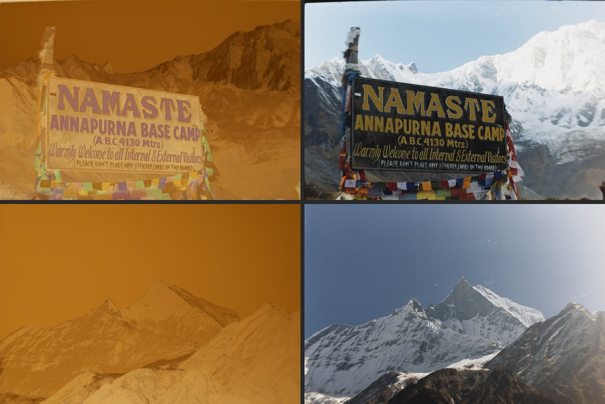

<h1 align="center">negg</h1>

<p align="center">
  <strong>Turn camera-scanned colour negatives into finished positives.</strong><br>
  Free and open source, for macOS, Windows and Linux. No Lightroom needed.
</p>

<p align="center">
  <a href="https://github.com/tomeggleston2436/negg/releases"></a>
  <a href="https://github.com/tomeggleston2436/negg/actions/workflows/ci.yml"></a>
  <a href="#licence"></a>
</p>

<!-- Screenshot of the frame screen: docs/images/app.jpg
<p align="center"></p>
-->

If you scan film with a digital camera, negg turns the negatives into
positives. Open a folder of RAW or TIFF scans as a roll and negg measures the
film itself: the orange base, the density range and the colour balance. It
pools those measurements across the whole roll, so every frame comes out
consistent. Then you pick a look, tweak it if you want, and export.

<!-- Before and after: docs/images/before-after.jpg
<p align="center"></p>
-->

## Features

- **Whole rolls at once.** The film base and colour are measured across the
  roll, not guessed frame by frame, so a sequence stays consistent.
- **Physical controls.** Density, grade, cyan, magenta and yellow, toe,
  shoulder and saturation behave like a colour darkroom print, not like
  generic photo sliders.
- **Tone presets.** Preview every preset on the frame you are looking at, apply
  one to a frame or the whole roll, and save your own.
- **Analysis area.** Leave the film holder out of the measurements without
  cropping the photo.
- **Export for print and for the web.** A full-quality 16-bit TIFF or JPEG,
  and a 2048 px sRGB JPEG ready for Instagram or a website, in one go.
- **Fast preview.** Renders on the GPU where there is one.
- **Never touches your scans.** Edits are saved in small `.negg.json` files
  next to them, so you can close and come back, or delete the files to
  start again.
- **A command line tool too.** Everything the app does, scriptable. Exports are
  byte-identical between the two.

## Install

Download the latest build from the
[Releases page](https://github.com/tomeggleston2436/negg/releases):

| System | File |
| --- | --- |
| macOS 11 or newer (Apple silicon and Intel) | `negg_<version>_universal.dmg` |
| Windows 10 or 11 | `negg_<version>_x64-setup.exe` |
| Linux | `negg_<version>_amd64.AppImage` |

negg is not signed with a paid certificate yet, so the first launch needs one
extra step:

- **macOS:** open the `.dmg` and drag negg to Applications. The first time you
  open it, macOS says it cannot check the app. Click **Done**, go to
  **System Settings > Privacy & Security**, scroll down and click
  **Open Anyway** next to negg. You only need to do this once.
- **Windows:** if SmartScreen says "Windows protected your PC", click
  **More info**, then **Run anyway**.
- **Linux:** make the AppImage executable (`chmod +x negg_*.AppImage`) and run
  it.

## Quick start

1. **Open a folder** of scans from one roll. negg lists the frames and writes
   nothing yet.
2. **Draw the analysis area** over the film, including its clear edge, and
   leave out the film holder. This only tells negg where to measure; it does
   not crop your photos.
3. **Press Analyse.** negg measures the roll and shows the positives.
4. **Pick a look.** Click a tone preset, or press `P` to step through them, and
   adjust the sliders if a frame needs it. `Cmd+Z` or `Ctrl+Z` undoes.
5. **Export** the frame, the frames you selected or the whole roll, as the
   original quality, a web copy, or both.

Arrow keys move between frames, `F` fits the photo to the window and `1` shows
actual pixels. The [app guide](app/README.md#what-it-does) covers every
control.

## What works with it

- **Scans:** RAW files from most digital cameras (decoded by
  [rawler](https://github.com/dnglab/dnglab)) and 16-bit TIFFs.
- **Film:** colour negative (C-41). Slide film and black and white are not
  supported.

## Status

negg is an early alpha. It works on real rolls, but expect rough edges:

- The built-in tone presets are a first pass and may change.
- There are no measured profiles for particular film stocks yet; negg works
  from what it measures on each roll.
- Updates are not automatic. Download the new version from the Releases page.

What is planned and what is not is in the [roadmap](ROADMAP.md).

## Found a problem?

[Open an issue](https://github.com/tomeggleston2436/negg/issues). Say which
camera and file type you scanned with and which system you are on. If you can,
attach the frame's `.negg.json` file; it holds the settings and measurements
but none of the photo.

## For developers

negg is a Rust engine with a command line tool and a
[Tauri 2](https://tauri.app) desktop app on top. The colour model is written
out in [docs/MATHS.md](docs/MATHS.md) and the design decisions are in
[docs/ADR](docs/ADR/).

| Crate | What it does |
| --- | --- |
| `negg-types` | `Image<f32>`, `Settings`, `RollSettings` and errors |
| `negg-decode` | RAW and TIFF input to linear camera RGB |
| `negg-calib` | Rig profiles: flat field, crosstalk, camera-to-density fit |
| `negg-film` | Film profiles, Dmin, Dmax and gamma estimators, roll pooling |
| `negg-render` | Inversion, print curve, adjustments, scopes and the GPU preview |
| `negg-cms` | Working space, ICC profiles and soft proof |
| `negg-io` | TIFF and JPEG writers, sidecars, profiles and presets |
| `negg-session` | Convert, batch, lock and roll flows; the `Session` the app drives |
| `negg-cli` | The `negg` binary ([usage](docs/CLI.md)) |
| `negg-ffi` | A C ABI over `negg-session` |

The desktop app is in [`app/`](app/README.md) and is its own cargo workspace,
so building the engine never needs Node.

```sh
cargo build --workspace
cargo test --workspace
cargo clippy --workspace --all-targets --all-features -- -D warnings
cargo fmt --all --check
cargo deny check     # needs cargo-deny
```

All five must pass before a change is merged. Changes to the engine are scored
by `negg eval` against a corpus of scans; see
[docs/EVALUATION.md](docs/EVALUATION.md). To build and run the app, see
[app/README.md](app/README.md).

## Licence

The engine crates (`negg-types`, `negg-decode`, `negg-calib`, `negg-film`,
`negg-render`, `negg-cms`, `negg-io`) are licensed under the
[Mozilla Public License 2.0](LICENSE-MPL-2.0). The command line tool, the C
ABI, the desktop app, the documentation and the profile data are licensed
under the [Apache License 2.0](LICENSE-APACHE-2.0). Each crate carries its own
`LICENSE` file and every source file has an SPDX header.

Dependencies must be MIT, Apache-2.0, BSD, MPL-2.0 or LGPL; no GPL or AGPL
code is allowed, and `cargo deny` checks this. `rawler` (LGPL-2.1) is used as
an ordinary dependency and never vendored; see [NOTICE](NOTICE).
